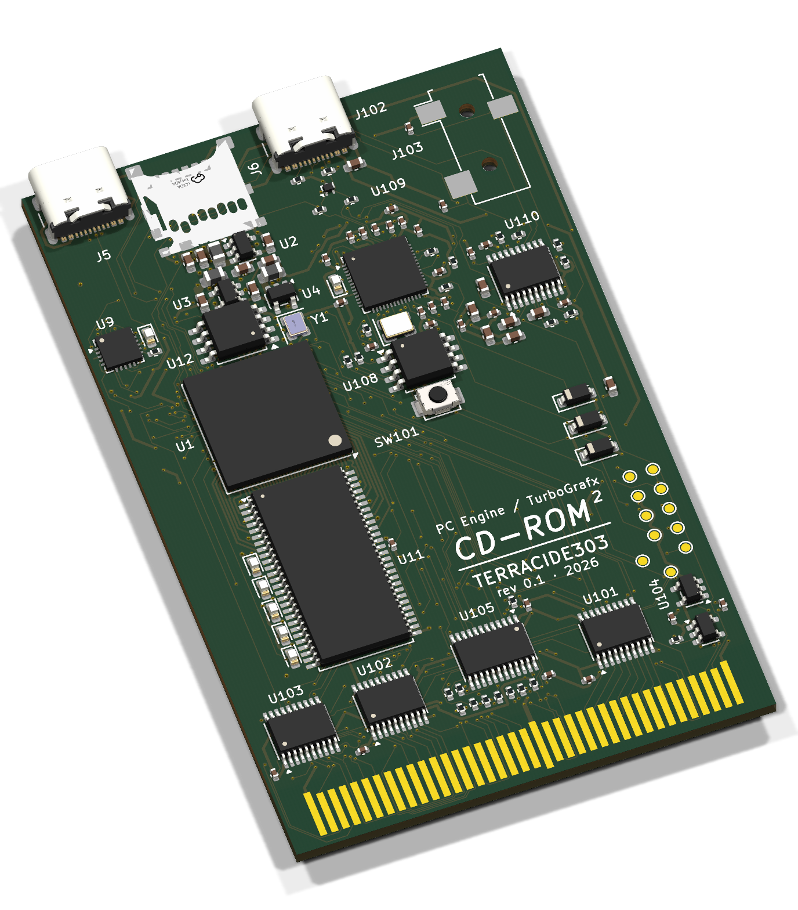

# PC Engine CD-ROM² card

> **Beta.** The PCB design is done, nothing has been built or tested yet. The FPGA core
> is still in development and will not be public until it is done.

A HuCard-sized card for the PC Engine / TurboGrafx-16. It plugs into the
**HuCard slot** and emulates the CD-ROM² system from a microSD card. No
expansion-port hardware and no CD unit are needed.

## On the card

- Lattice ECP5-45F FPGA with SDRAM and config flash (core section after the Icepi Zero)
- RP2040 companion and microSD
- Two USB-C ports: FPGA programming (FT231X) and the RP2040
- PCM5102A audio DAC: a stereo 3.5 mm jack, plus mono to the console
- 5 V bus translators at the card edge
- 4 layers, 54.1 × 85.4 mm, 1.6 mm, ENIG gold fingers

## Status

| part | state |
|---|---|
| schematic | done, checked |
| PCB | done, beta |
| FPGA core | in development, not public yet |
| ordered / tested | no |

## Layout

- `hw/card/`: KiCad project
- `tools/`: scripts that generate, check and lay out the board, and make the fab files
- `docs/`: [the card](docs/CARD.md), [how it is built](docs/WORKFLOW.md), [ordering](docs/ORDER.md); old notes in `docs/archive/`

## Credits

- [Icepi Zero](https://github.com/cheyao/icepi-zero) (Solderpad 2.1): the FPGA core section of the board
- [MiSTer TurboGrafx-16 core](https://github.com/MiSTer-devel/TurboGrafx16_MiSTer): reference for the CD hardware
- [HuCARD-repro](https://github.com/partlyhuman/HuCARD-repro): HuCard dimensions
